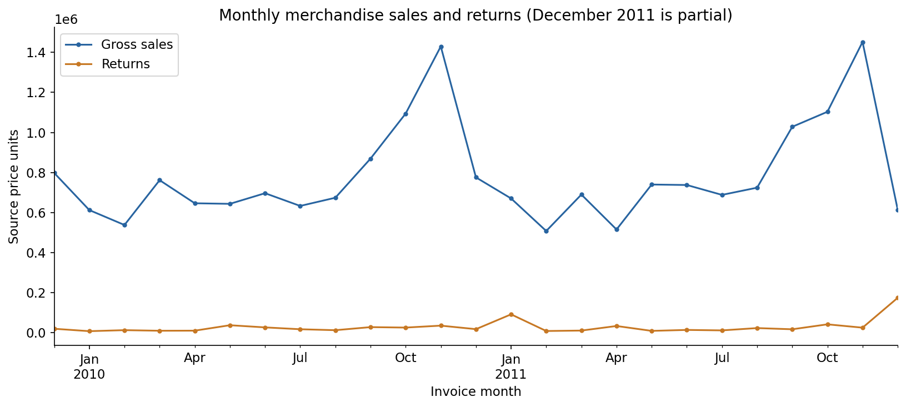
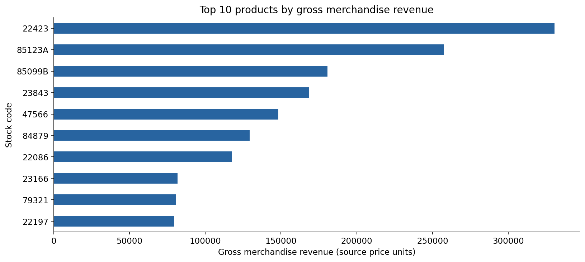

# Retail Customer & Sales Analysis

Python and Tableau analysis of merchandise sales, customer purchasing patterns, product concentration, and cancellations for an online retailer.

## Business problem

Understand which customers, products, and countries contribute to sales; assess year-over-year performance on comparable periods; and distinguish broad return patterns from exceptional cancellations. The findings support inventory prioritization, customer retention, and investigation of high-value returns.

## Dataset

The project uses the supplied `online_retail_I.csv` and `online_retail_II.csv` extracts. Each row is an invoice line with eight fields: invoice number, stock code, description, quantity, invoice date, unit price, customer ID, and country.

- Observation window: December 1, 2009–December 9, 2011.
- Combined records after resolving the overlapping extract dates: **1,044,848**.
- Final merchandise sales: **1,003,357** rows; returns: **17,915** rows.
- December 2011 is incomplete. Year comparisons use January–November only.

The original dataset download URL, currency documentation, and license were not supplied. Amounts below are in source price units. Local raw files are provided for reproduction but excluded from Git until redistribution rights are confirmed; see [data setup](data/README.md).

## Data-cleaning decisions

1. Parse invoice dates and use string types for invoice/product identifiers and nullable integers for customer IDs.
2. Compare the overlapping extracts, including duplicate multiplicities, and stop if they differ. Retain the second extract for overlapping dates.
3. Remove exact duplicate rows. This assumes identical rows are repeated records rather than legitimate repeated lines.
4. Define merchandise sales as non-cancellation records with positive quantity and price, excluding the original project's explicit adjustment-code list.
5. Separate C-prefixed cancellation invoices from sales. Validate negative quantities and positive prices, then express returned units and value as positive magnitudes.
6. Exclude administrative stock codes, postage, fees, bad debt, zero-price entries, and inventory corrections from merchandise KPIs. Preserve the original sales and cancellation exclusion lists explicitly in the notebook.
7. Keep anonymous sales in aggregate revenue. Use identified customers only for customer-level analysis; do not impute customer IDs.
8. Retain exceptional sales and returns in totals and investigate their concentration separately.

## Main analysis

- Sales, recorded returns, observed net merchandise revenue, order counts, and units.
- Monthly performance, order-value distributions, and country revenue.
- Identified-customer coverage, purchase frequency, spending, and concentration.
- Product revenue, units, invoice frequency, and customer reach.
- Product/customer return summaries and exceptional cancellation invoices.
- January–November 2010 versus 2011 comparisons.
- Pearson/Spearman associations and a two-sided Welch test of mean invoice values.

## Key findings

| Metric | Result |
|---|---:|
| Gross merchandise revenue | 19,643,861.64 |
| Recorded return value | 716,462.57 |
| Observed net merchandise revenue | 18,927,399.07 |
| Sales invoices | 39,516 |
| Identified purchasing customers | 5,852 |
| Products sold | 4,896 |
| Returned value / gross sales | 3.65% |
| Returned units / sold units | 4.18% |

- **Product concentration:** the top 489 products, approximately 10% of the catalog, generate **62.55%** of gross merchandise revenue. Prioritize their availability while checking whether individual products rely on exceptional orders.
- **Customer visibility:** identified customers account for **86.89%** of gross revenue. Findings about repeat behavior cover this subset only.
- **Exceptional cancellations:** two cancellation invoices account for **34.29%** of all return value. Investigate these before interpreting return spikes as a general customer trend.
- **Comparable growth:** January–November revenue increased **3.00%** in 2011, while sales invoices fell **3.71%** and units fell **5.96%**. Identified purchasing customers increased **0.99%**.
- **Order mix:** mean invoice value increased **6.97%**, compared with **1.11%** for the median. The Welch test gives **p = 0.00988**; skew, extreme orders, and repeated customers limit the inference. Statistical significance does not establish a causal explanation or a material improvement in the typical order.

Observed net merchandise revenue equals gross merchandise revenue minus recorded merchandise returns. It is not profit and does not include all accounting adjustments.





## Tableau dashboard

[View the author's Tableau Public profile](https://public.tableau.com/app/profile/mohmmadsadegh.rahmani/vizzes).

The supplied link is a profile rather than a direct workbook URL. A specific published dashboard and its current data have not been verified. The notebook regenerates `generated/online_retail_tableau.csv` for use in Tableau; no published workbook has been modified.

The export includes transaction type, date, country, product, customer ID, sales quantity, return quantity, gross revenue, return value, and net revenue. Calculate dashboard ratios using ratios of sums, for example `SUM(Return_Value) / SUM(Gross_Revenue)`, rather than averaging row-level percentages. Return values are positive magnitudes and return net revenue is negative. `Quantity` is positive for returns in this export, preserving the original export convention; use the explicit sales/return quantity fields.

## Tools

**Python**, **Pandas**, NumPy, Matplotlib, **SciPy**, Jupyter, and **Tableau Public**.

## Run the project

Use Python 3.12 and place both original CSV files in `data/`. The delivered local folder already contains them.

```bash
python -m pip install -r requirements.txt
jupyter lab
```

Open `retail_analysis.ipynb` from the project root, then choose **Restart Kernel → Run All**. The notebook creates the Tableau CSV, chart PNGs, and `validated_metrics.json` under `generated/`. Saved notebook outputs make the findings readable without executing the analysis.

For automated execution:

```bash
python -m jupyter nbconvert --to notebook --execute --inplace retail_analysis.ipynb
```

## Limitations

- Historical observational data cannot establish causality or current business performance.
- December 2011 is partial; returns may relate to sales outside the observed period.
- Missing customer IDs limit customer-level coverage and anonymous repeat-purchase analysis.
- C-prefixed invoices identify cancellation records; they do not reliably link returns to original sale lines. Return-to-sales ratios are window-based comparisons, not cohort return probabilities.
- Manual adjustment-code exclusions and exact-row deduplication need business-owner confirmation.
- Outliers materially affect averages. They are retained and separately examined.
- No costs, margins, stock availability, customer acquisition, or marketing data is provided.
- Source currency, original download URL, and redistribution license are not documented in the supplied material.
- Welch inference treats invoices as independent despite repeated customers and is descriptive rather than causal.

## Project files

- `retail_analysis.ipynb`: cleaned analysis with saved outputs.
- `requirements.txt`: environment dependencies.
- `data/README.md`: input schema and data placement instructions.
- `generated/`: figures, validated metrics, and the locally generated Tableau export.
- `VALIDATION.md`: execution and review status.

Raw data, the large generated CSV, and the optional HTML preview are excluded from Git. They remain available in the local delivery.
